# Phase 4 – Security Hardening

---

## Overview

This phase focused on hardening the homelab environment across four areas: OPNsense intrusion detection and prevention, Proxmox host security, network segmentation using VLANs, and certificate management. The goal was to move from a functional but default-configured lab into a more secure and production-realistic environment.

---

## Status

| Sub-Phase | Status |
|---|---|
| 4.1 – OPNsense IDS/IPS (Suricata) | ✅ Complete |
| 4.2 – Proxmox Host Hardening | ✅ Complete |
| 4.3 – Network Segmentation / VLANs | 🟡 VLANs built and verified in [Phase 5](../05-vlans/); least-privilege rules between VLANs next |
| 4.4 – Certificate Management | 🔲 Planned |

---

## Objectives

- Enable and tune Suricata IDS/IPS on OPNsense for threat detection
- Harden the Proxmox host (disable root SSH, enable 2FA, configure datacenter firewall)
- Design and implement VLAN segmentation (Trusted, Servers, IoT, Lab, Management)
- Replace self-signed certificates with trusted certs via Let's Encrypt or an internal CA

---

## Technologies Used

- Proxmox VE
- OPNsense
- Suricata (IDS/IPS)
- Let's Encrypt / ACME
- OpenSSL (internal CA)
- Linux Networking
- Virtual Bridges (vmbr0, vmbr1, vmbr2)
- Google Authenticator / TOTP (Proxmox 2FA)

---

## Phase Breakdown

### Phase 4.1 – OPNsense IDS/IPS (Suricata) ✅

**Key Configuration Steps**

1. Install the Suricata plugin via OPNsense package manager
2. Enable Suricata on the WAN interface
3. Download and activate Emerging Threats Open ruleset
4. Set interface to IPS mode (inline) to block, not just alert
5. Configure alert logging and review the live log
6. Tune false positives by suppressing noisy rules
7. Validate IPS is blocking test traffic

**Screenshots**

Suricata settings:

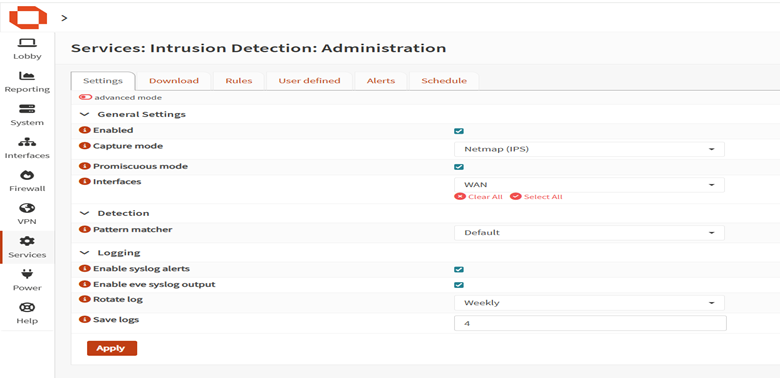

Downloading the rulesets:

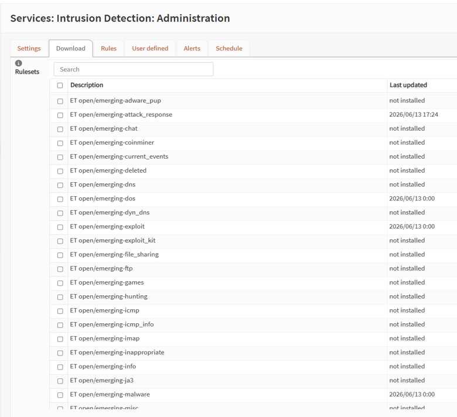
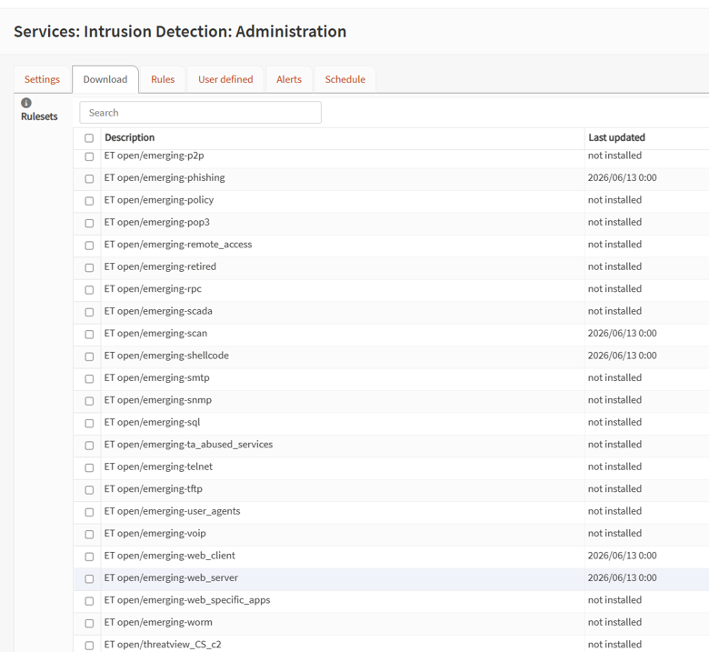

Active rules:

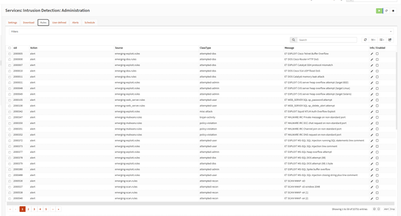

Live alerts:

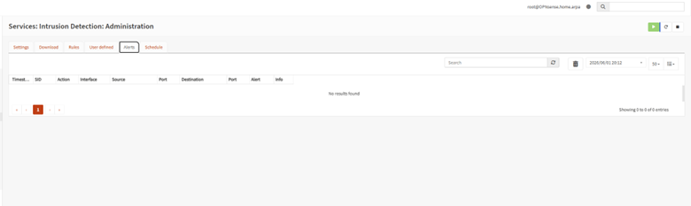

---

### Phase 4.2 – Proxmox Host Hardening ✅

**Key Configuration Steps**

1. Disable root SSH login (`PermitRootLogin no` in `/etc/ssh/sshd_config`)
2. Create a non-root admin user with `sudo` privileges
3. Enable two-factor authentication (TOTP) on the Proxmox web UI
4. Configure the Proxmox datacenter firewall with default DROP policy
5. Add explicit ACCEPT rules for management access (SSH, web UI)
6. Disable the Proxmox subscription nag (optional)
7. Review and restrict API token permissions

**Screenshots**

SSH hardening:

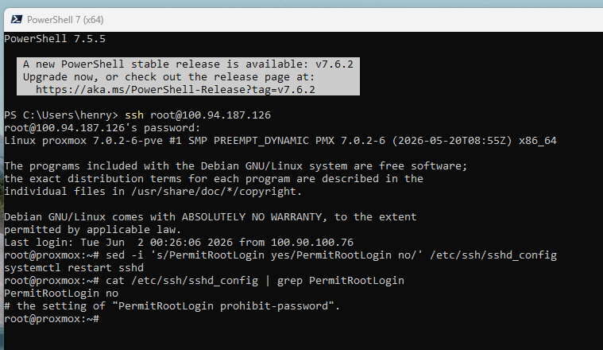

Two-factor authentication, before and after:

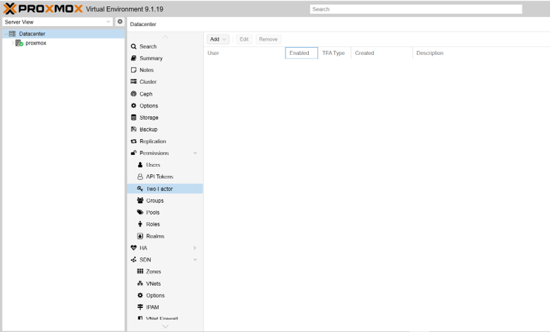
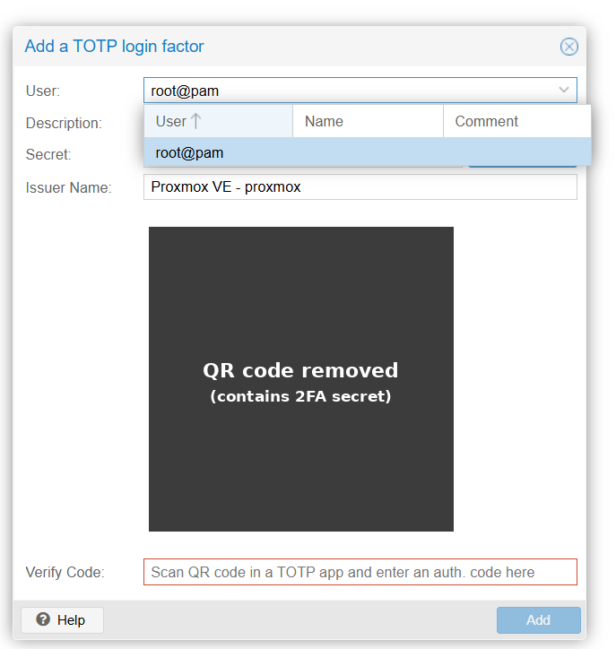
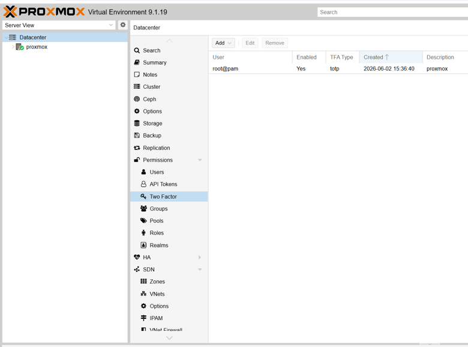

Tailscale access rules on the Proxmox firewall:

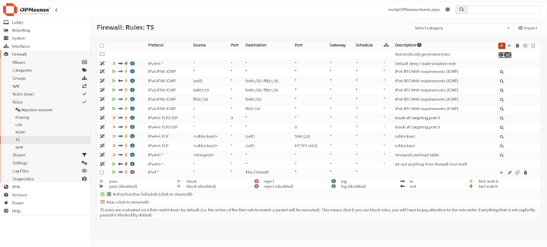
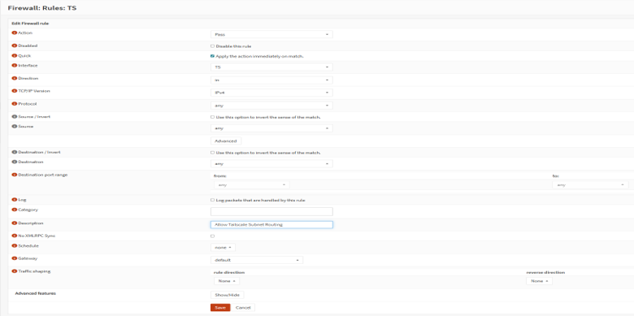
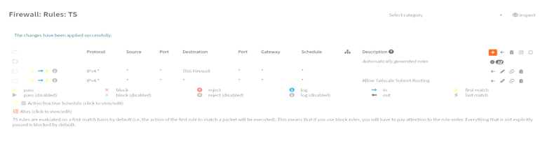

Building the management rules, from an empty rule set to the firewall enabled:

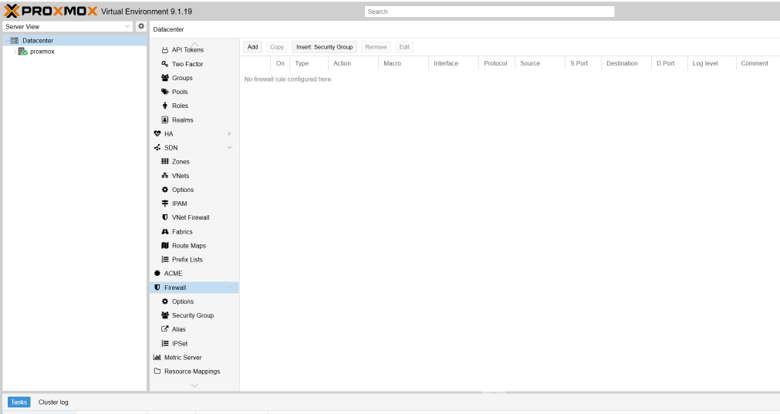
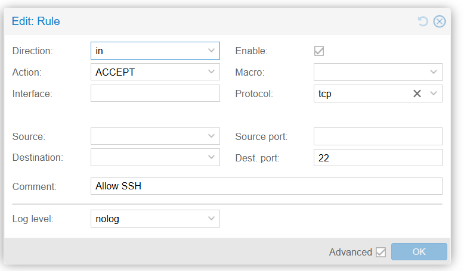
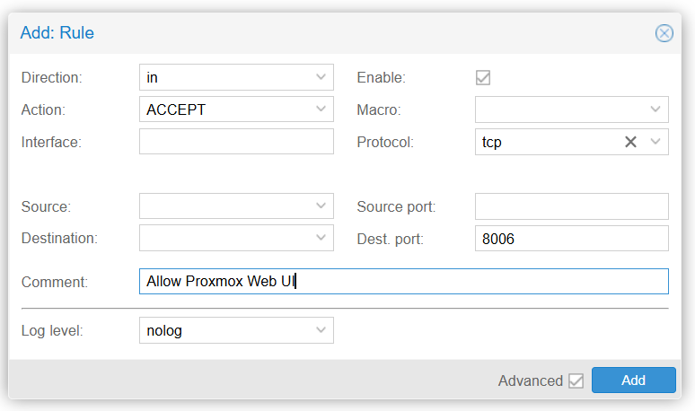
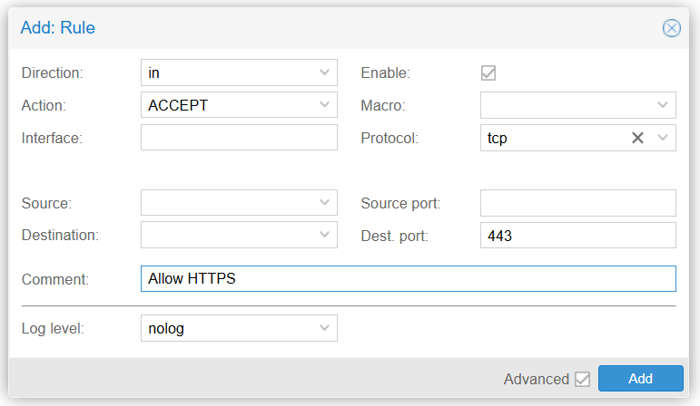
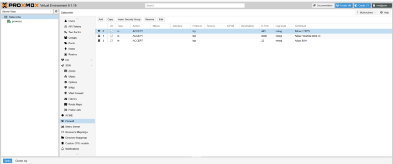
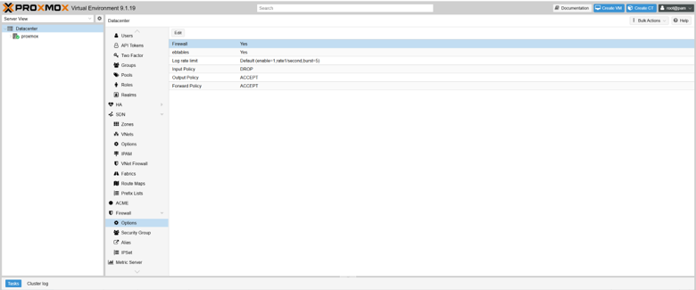

---

### Phase 4.3 – Network Segmentation / VLANs 🟡

The VLAN build is documented in full in **[Phase 5 – VLANs](../05-vlans/)**.

**Done**
- VLAN-aware Proxmox bridge and OPNsense trunk carrying VLANs 10, 20, 30 and 40
- VLAN interfaces and Kea DHCP scopes in OPNsense
- Domain controller moved to the Servers VLAN (20) and verified
- Separate out-of-band management network (192.168.99.0/24)

**Next**
- Default deny between VLANs, with only explicit exceptions allowed
- IoT (30) limited to internet access only
- Lab (40) isolated from Servers and Trusted
- Cross-VLAN block tests, with screenshots

---

### Phase 4.4 – Certificate Management 🔲

**Planned Steps**

1. Choose certificate strategy (Let's Encrypt for public domain OR internal CA for LAN-only)
2. **Let's Encrypt path:** Install ACME plugin in OPNsense, configure DNS challenge, issue cert for OPNsense web UI
3. **Internal CA path:** Create a root CA with OpenSSL, import into OPNsense as a trusted CA
4. Issue and install a certificate for the OPNsense web UI
5. Issue and install a certificate for the Proxmox web UI
6. Import the CA cert into browser/OS trust store on admin machines
7. Verify HTTPS access with no browser warnings on both UIs

---

## Skills Demonstrated

- Intrusion detection and prevention (IDS/IPS)
- Host hardening and least-privilege access
- Multi-factor authentication
- VLAN design and implementation
- Firewall rule logic and network segmentation

---

## Notes

This phase moved the homelab from a functional default setup toward a hardened, segmented environment closer to real-world network architecture. Each sub-phase builds on the previous one: segmentation is most effective once the firewall (IDS/IPS) and host access (Proxmox hardening) are locked down first. Certificate management comes last so valid HTTPS is available across all management interfaces.
