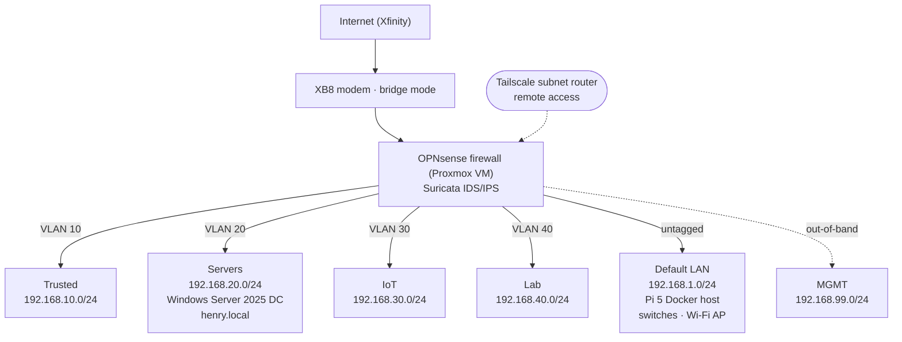

# Proxmox Homelab

A segmented home network built on **Proxmox VE**, with an **OPNsense** firewall, **VLAN segmentation**, **Suricata IDS/IPS**, a **Windows Server 2025 Active Directory** domain controller and **Tailscale** remote access. Every phase is documented with configuration steps, screenshots and the problems I hit along the way.

---

## At a glance

| Layer | What's running |
|---|---|
| Hypervisor | Proxmox VE 9 on a Ryzen 7 3700X with 32 GB RAM |
| Firewall / router | OPNsense VM; the ISP modem runs in bridge mode, so OPNsense is the only router |
| Segmentation | VLANs 10 Trusted, 20 Servers, 30 IoT, 40 Lab, plus an out-of-band management network (99) |
| Intrusion detection | Suricata IDS/IPS with Emerging Threats Open rules |
| Identity | Windows Server 2025 Active Directory domain controller (`henry.local`) on the Servers VLAN |
| Remote access | Tailscale subnet router; Proxmox web UI protected with TOTP two-factor authentication |
| Services | Raspberry Pi 5 running a Docker stack: monitoring, reverse proxy, Wi-Fi controller and a honeypot |

---

## Network diagram

---

## Phases

| Phase | What it covers | Status |
|---|---|---|
| [01 – Installation](01-installation/) | Proxmox VE on bare metal, host hardware | ✅ Complete |
| [02 – VM setup](02-vm-setup/) | Building the OPNsense VM: UEFI, CPU, memory, disks, bridges | ✅ Complete |
| [03 – OPNsense deployment](03-opnsense-deployment/) | WAN/LAN, management network, Tailscale, firewall rules, moving the modem to bridge mode | ✅ Complete |
| [04 – Security hardening](04-security/) | Suricata IDS/IPS, Proxmox SSH hardening, 2FA, Proxmox firewall | ✅ IDS/IPS and host hardening done · certificates planned |
| [05 – VLANs](05-vlans/) | VLAN-aware bridge, OPNsense trunk, Kea DHCP per VLAN, domain controller moved to the Servers VLAN | ✅ Complete |
| [06 – Docker services](06-docker-services/) | Raspberry Pi 5 container stack | 🟡 In progress |

---

## Problems solved

- **VLAN tags silently dropped.** Traced to the Proxmox per-VM firewall wrapper (`fwbr`) breaking VLAN tagging. Disabled it on tagged NICs and let OPNsense enforce policy. ([Phase 5](05-vlans/))
- **Trunk not carrying VLANs.** The OPNsense VM's NIC had never carried tagged traffic. Fixed by setting `trunks=10;20;30;40` on that NIC. ([Phase 5](05-vlans/))
- **Domain controller on its own segment.** Moved the DC from Trusted to a dedicated Servers VLAN to model enterprise segmentation. ([Phase 5](05-vlans/))
- **Double NAT removed.** Put the ISP gateway into bridge mode so OPNsense holds the public IP. ([Phase 3](03-opnsense-deployment/))
- **Break-glass access.** Built a separate, out-of-band management network to reach OPNsense and Proxmox if the main network fails. ([Phase 3](03-opnsense-deployment/))

---

## Technologies

- **Virtualization:** Proxmox VE 9, KVM virtual machines, VLAN-aware Linux bridges
- **Networking:** OPNsense, 802.1Q VLANs, Kea DHCP, NAT, managed switches, TP-Link Omada Wi-Fi
- **Security:** Suricata IDS/IPS (ET Open), firewall rule design, TOTP 2FA, SSH hardening, Tailscale
- **Identity:** Windows Server 2025, Active Directory Domain Services, DNS
- **Services:** Docker on Raspberry Pi 5 (Portainer, Nginx Proxy Manager, Grafana, Uptime Kuma, Netdata, Omada Controller, Cowrie honeypot)

---

## Roadmap

- [ ] Least-privilege firewall rules between VLANs (default deny, IoT internet-only, Lab isolated)
- [ ] Active Directory: OUs, users, groups, Group Policy and a domain-joined Windows 11 client
- [ ] Vulnerability scanning and remediation (Nessus Essentials)
- [ ] Wazuh SIEM collecting OPNsense, Suricata and Windows logs
- [ ] Trusted certificates for management interfaces (Phase 4.4)
- [ ] Isolated OT/ICS segment (OpenPLC and Modbus/TCP)
- [ ] Scheduled backups with tested restores and a recovery runbook

---

## About

Built and maintained by **Henry Mendez**: B.S. in Computer Science (Networks and Security concentration, Cybersecurity minor) and CompTIA Security+. Currently studying for the Cisco CCNA.

---

## Disclaimer

This repository is for educational and lab purposes only. All configurations were performed in a controlled homelab environment.
